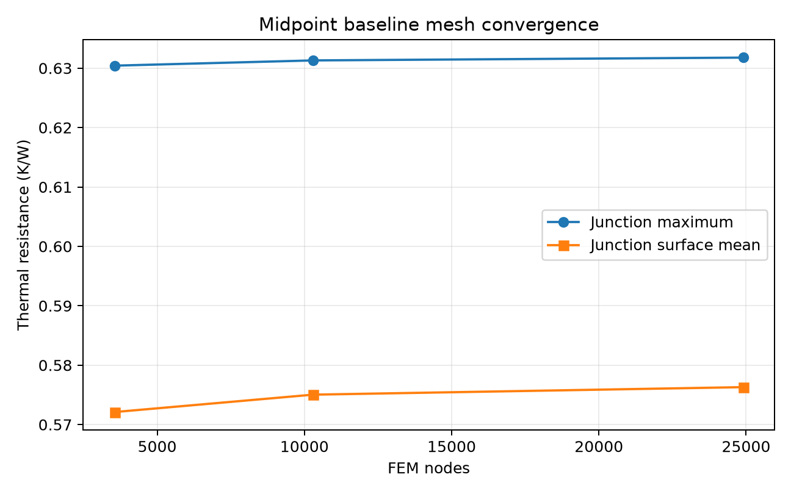
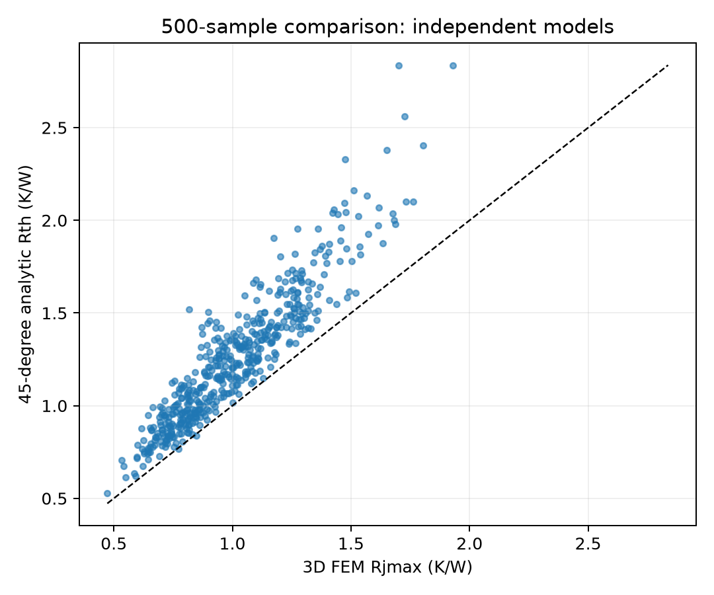
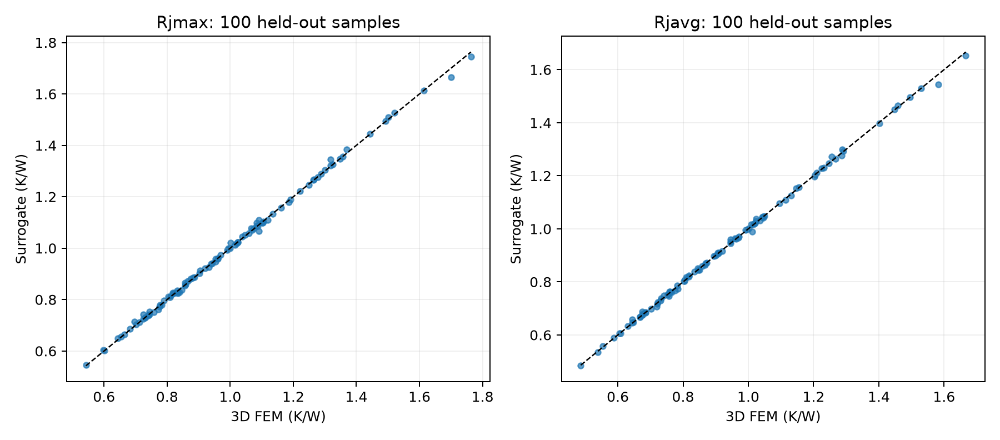
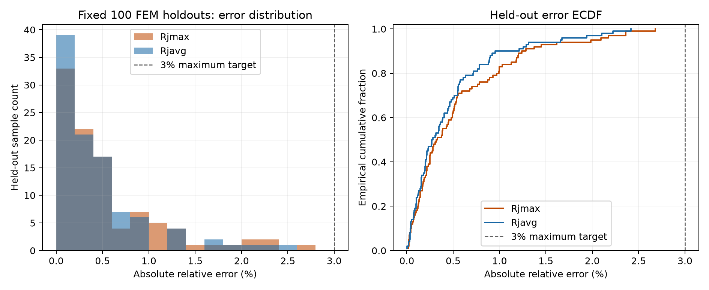

# P2 结果与验证索引

真实三维 FEM 数据与浏览器代理已完成。500 组 LHS 分为 400 组训练、100 组留出测试；最终标量模型在这 100 例上达到平均 <1%、最大 <3% 的目标。

| 最终验收 | Rjmax | Rjavg |
| --- | --- | --- |
| 100 留出例平均相对误差 | 0.5490% | 0.4566% |
| 100 留出例最大相对误差 | 2.6801% | 2.4177% |
| 固定 seed 随机 20 例最大误差 | 2.3620% | 2.1033% |

Vitest **30/30**、严格 TypeScript 检查通过。标量 JSON 216,323 字节，含 POD 模型合计 509,168 字节；8 模态保留归一化中心化场的 99.9288% 平方能量。实际 Node 22 主机标量 p95 0.0302 ms，标量加场重建 p95 0.1262 ms。

**审计限制必须随结果保留：100 例留出集在早期模型评估时已经被检查，最终属于复用留出集，不是完全未触碰的盲测。** 最终候选仅依据 400 例训练集三折交叉验证选择，未用留出标签拟合或排序候选。三折 CV 的最大误差仍为 8.5695% / 8.5118%（每折只用约 267 例训练），因此 100 例结果不能视为全参数域 <3% 的保证。完整选择、首次失败审计、方法和适用边界见 [代理方法报告](SURROGATE.md)。

## FEM 求解与数据

| 项目 | 实际结果 | 证据 |
| --- | --- | --- |
| 数值方法 | 三维 Q1 六面体 FEM，四分之一对称域、理想接触 | [方法报告](SOLVER-REPORT.md) |
| 最终网格 | 24,897 节点、21,648 六面体，每个焊层厚度方向 6 单元 | [网格配置](reports/selected-mesh.json) |
| 三档中点收敛 | L2→L3：Rjmax 变化 0.07490%，Rjavg 变化 0.22023% | [原始 CSV](reports/convergence.csv) |
| 500 样本最大相对残差 | 1.05151×10⁻¹² | [运行验证](reports/dataset-verification.json) |
| 500 样本最大热平衡误差 | 1.94632×10⁻¹² | [运行验证](reports/dataset-verification.json) |
| 固定数据划分 | 400 train / 100 test，LHS seed 20261014 | [参数 CSV](data/parameters.csv) |
| Float16 场量化最大有效点相对误差 | 0.0487924% | [数据验证](reports/data-verification.json) |

独立解析模型与 FEM Rjmax 的 Pearson 相关系数为 0.92654，但平均绝对相对误差为 **24.0199%**，最大为 **85.6094%**。相关性不能代替误差验证。

## 代理模型与浏览器推理

以下文件由最终真实训练、导出和 TypeScript 测试生成：

- [训练集内模型选择记录](reports/model-selection.json)：候选模型与选择过程。
- [最终留出集标量误差](reports/scalar-holdout.json)：最大/平均结温热阻误差及验收标志。
- [代理模型综合验证](reports/surrogate-validation.json)：POD 能量、场误差、大小及训练时间。
- [逐样本预测 CSV](reports/holdout-predictions.csv)：100 个留出 FEM 对照。
- [TypeScript 验证](reports/typescript-validation.json)：Python/TypeScript 一致性、固定 seed 随机 20 例、全 100 例和实际推理性能。

实际部署的 Float16 POD 场平均/最大 NRMSE 为 0.6231% / 2.9458%（以各样本 FEM Rjmax 归一化），详见 [导出场验证](reports/field-export-validation.json)。

是否通过用户指标必须读取最终验收标志，不能从文件存在或“训练完成”推断。训练入口保留失败时生成的证据；一键复现入口会在精度或大小验收未通过时退出失败。

## 可复现性与适用范围

[README](README.md) 提供完整求解→训练的一条入口命令、复用已有数据的方法及固定镜像 Docker 配置。原生 Python 求解与数据检查已实际运行；Docker 镜像摘要已核实，但本地 daemon 不可用，容器构建/运行未验证。

方法假设、单位、非均匀场坐标、物理与数值限制、完整官方工具来源见 [SOLVER-REPORT](SOLVER-REPORT.md)。本报告不提供实验验证或量产适用性结论。
## v2 复核

本版未改变 FEM 数据和最终模型；新增数据追溯、15 次直接 FEM 边界载荷验证，以及覆盖全部 100 个留出参数的 P/T_cool 仿射关系测试。完整结果与浮点边界见 [V2-VALIDATION.md](V2-VALIDATION.md)。
